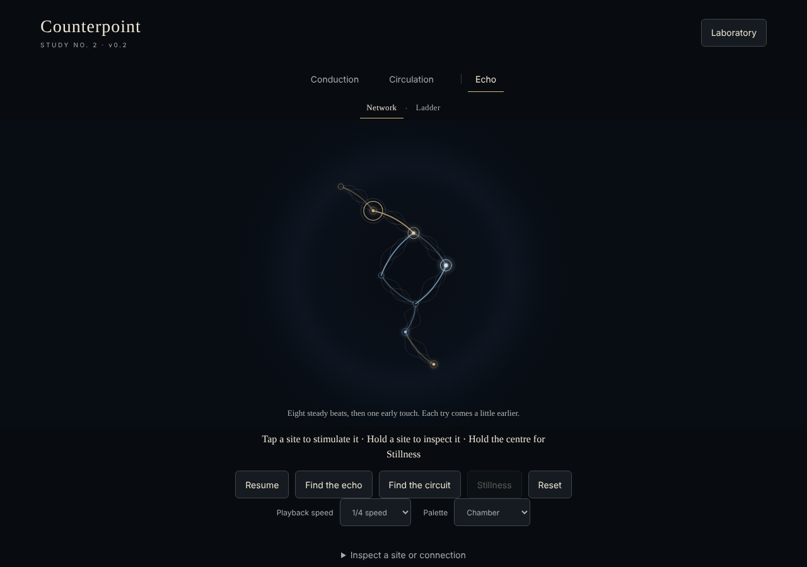
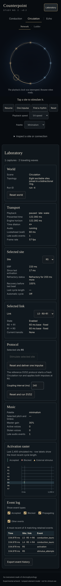

# Simplify M4 · fewer controls, clearer instructions

**Date:** 2026-11-27 · **Branch:** `study-2-simplify` (from `main` at `93f1ee5`)

Creator requests 1, 3, 4, 7, 8 and 9 from the 2026-11-27 review. Requests 2, 5 and 6 are milestones M5 and M6.

| # | Request | Change |
|---|---|---|
| 1 | Remove breaking connections | Swipe-to-cut, the connection toggle buttons and Restore all connections are gone. A drag on the map does nothing: a pointer that travels 10 px or more stops being a tap or a hold. The engine's `setLinkEnabled` command and its tests stay for replays and future studies. |
| 3 | Fractions only | Playback speed reads `1/4 speed` … `1/12 speed`. |
| 4 | Instructions visible but short; highlight the selected site | One serif line at 16 px sits directly above the controls. Conduction and Circulation: "Tap a site to stimulate it." Echo: "Tap a site to stimulate it · Hold a site to inspect it · Hold the centre for Stillness". The selected site draws a gold double halo on the network map (`renderer.setSelected`, exposed as `counterpoint.selectedSite`). |
| 7 | No S key | The Stillness shortcut is removed. Stillness stays on its button and on a hold of the open centre. |
| 8 | Remove the Echo header | `#study-line` (numeral, name, subtitle, Notes link) is gone. The liner notes are still reachable from the Laboratory. |
| 9 | No volume or mute | Both controls are removed and the mixer is always unmuted. People use their device's volume. |

## Checks

- `npm test`: 180 pass. `npm run check:contract`, `node tests/host-integration.mjs` (a drag submits no command, no cut buttons), `node tests/music-offline.js` and `npm run build:site` pass.
- `tests/browser_integrate.py` (Echo, 1280×900 and 390×844) passes. New assertions:
  - no header, mute or volume control;
  - fraction labels;
  - instructions visible at 16 px or larger;
  - the selected site follows hold-to-inspect.
- `tests/browser_smoke.py` passes on desktop and on a 360 px phone. It was out of date: it still expected Duality, cutting, mute and volume. Now:
  - it checks that a drag cuts nothing;
  - it resumes after a headless late-wake pause;
  - it expects the URL fragment to keep the chosen world across a reload.

## Test-host notes

- Headless Chromium sometimes pauses playback with a late wake after a screenshot. The sites are disabled while paused, so both suites resume before any keyboard step.
- After a raw CDP touch sequence, headless Chromium drops the click of the next real tap. The smoke suite settles it with one tap on the footer. A full touch sequence on a real device does not do this.
