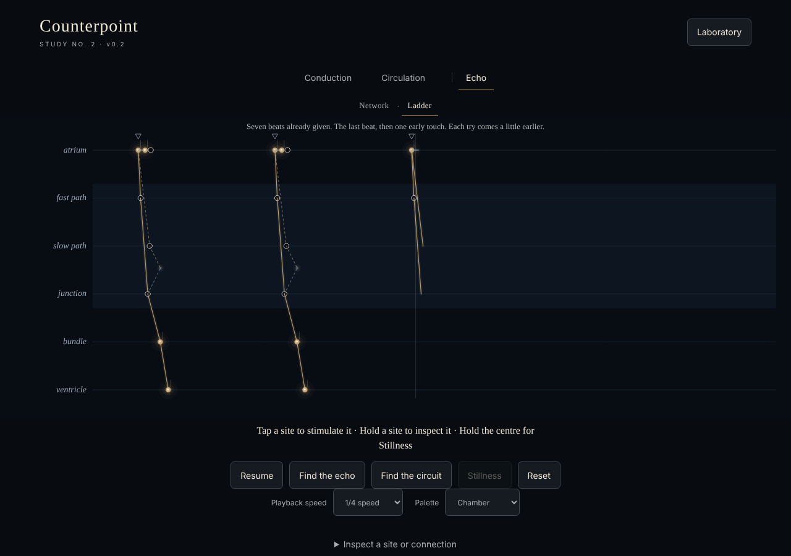

# Simplify M5 · preconditioned guided runs

**Date:** 2026-11-27 · **Branch:** `study-2-simplify`

Creator request 2: at 1/8 speed, waiting through eight drive beats before the extrastimulus is too slow. Find the echo and Find the circuit now begin with the model as it stands after the 7th S1. Playback starts with the last S1, then the S2 (and S3).

## How it works

- `transport.reset(world, runId, { commands, fromMs })` enqueues the same commands as before. It then advances the engine silently to `fromMs` and starts the playback clock there.
  - The prelude's events go to a new `onPrelude` callback, never to `onCommit` (sound) or the frame queue (animation).
  - Live input is stamped after `fromMs`.
- Echo's guided protocols set `presentFromMs: 4100`, 300 ms before the last S1 at 4400 ms. At 1/8 speed the first S1 sounds 2.4 s after the press and the S2 at 380 ms arrives after 5.4 s; before, it arrived after 38 s.
- The app keeps the prelude events (`retainEvents`). The ladder therefore shows the earlier drive beats as context, and the raster, live S1–S2 curve and export see the whole run.
- The status line now reads "Seven beats already given. The last beat, then one early touch. Each try comes a little earlier." Find the circuit says "two early touches".

## Determinism

`tests/precondition.test.js` (5 tests):
- For S2 = 380 and 260, and the circuit at 280, the prelude plus the committed events equal the full run's events through 6000 ms. The engine state at 6000 ms and the command log also match.
- The prelude holds exactly the seven drive beats (200 … 3800 ms), and every prelude activation ends more than 50 ms before 4100 ms: the circuit is quiet when playback begins.
- No prelude event is committed for sound. The first presented frame is at 4100 ms, and the last S1's onset is 2.4 s after Begin at 1/8 speed.

## Checks

185 Node tests pass. `npm run build` and `node tests/host-integration.mjs` pass, and `tests/browser_integrate.py` passes at desktop and phone sizes. The browser step now checks the seven-beat prelude right after the press and a presented time of at least 4100 ms.
