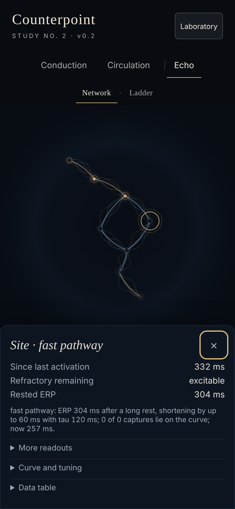
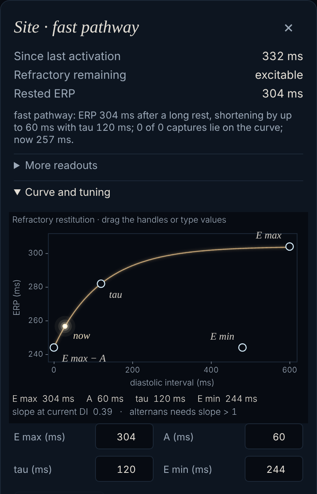

# Simplify M6 · layered inspector card, inspect in every world

**Date:** 2026-11-27 · **Branch:** `study-2-simplify`

Creator requests 5 (the inspector details are overwhelming) and 6 (inspect and tune in every study).

## Layered card

The card now opens with only:
- the title, a "modified" badge and Close;
- **three key readouts**:
  - for a site: Since last activation, Refractory remaining, Rested ERP;
  - for a connection: State, Delay now, Last conduction time;
- the one-line summary. Its live ERP ("now …") is rounded to whole milliseconds.

Everything else sits under three collapsible sections, all closed at first:
- **More readouts:** last cycle length, recovery, current DI, ERP of the last capture; for a connection, last recovery and lesion.
- **Curve and tuning:** the restitution or conduction plot with its draggable handles, the number fields, Study default and the note.
- **Data table.**

A section the player opens stays open when they inspect another element, so someone tuning several sites does not reopen it each time.

 

## Every world

- Conduction and Circulation now have the inspector card. It opens by holding a site or connection, by pressing I on a focused site, or from the "Inspect a site or connection" list.
- Edits are the same logged commands as in Echo, and they carry into the next run. Worlds without restitution expose ERP and conduction delay.
- Both hints now read "Tap a site to stimulate it · Hold a site to inspect it".
- These stay Echo-only: Stillness (button and centre hold), the live S1–S2 curve, the protocol runner and the Lab Model sliders.

## Checks

- 187 Node tests pass. They include two new card tests:
  - three key readouts, sections closed at first, and an opened section that stays open across elements;
  - tuning an ERP in Circulation.
- `check:contract`, `host-integration` (its harness now provides `structuredClone`, as browsers do), `music-offline` and `build:site` pass.
- Both Chromium suites pass. The smoke suite now opens the Circulation card with the I key and checks three key readouts and a closed Curve and tuning section.
