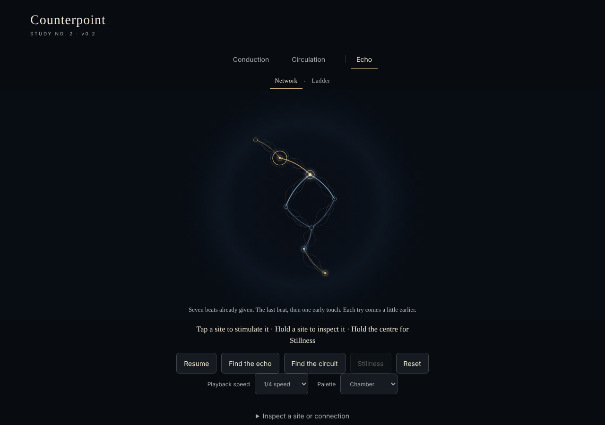
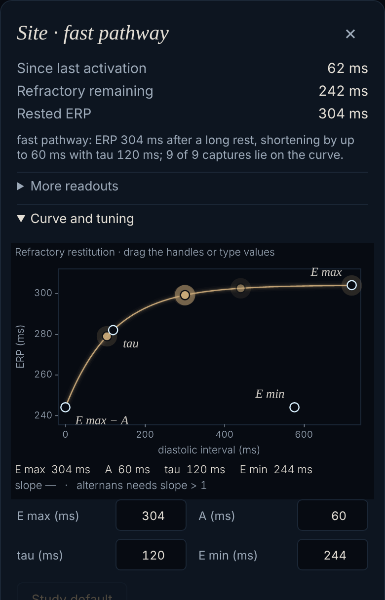
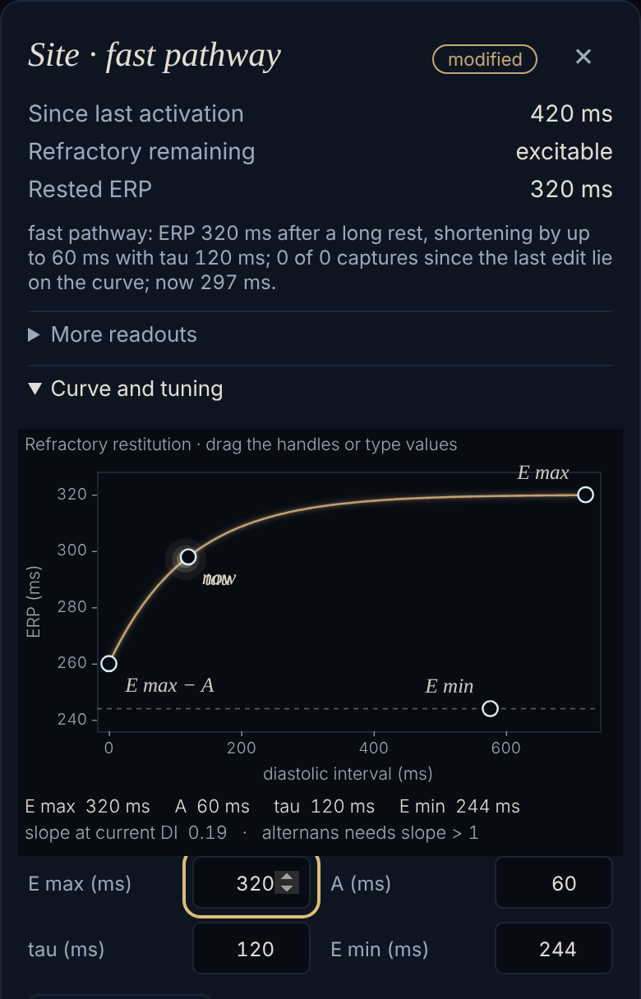

# Simplify M8 · Laboratory hidden; card curves reset on edit

**Date:** 2026-11-27 · **Branch:** `study-2-lab-off`

## 1 · Laboratory hidden

"I don't think the Laboratory does anything right now. Let's get rid of it for the time being."

- `SHOW_LABORATORY = false` in `src/ui/studies.js` hides the Laboratory button and panel. The page starts with the button hidden, so it never flashes.
- The panel's code stays in source: diagnostics, raster, event log and export; the live S1–S2 curve; Model sliders; the protocol runner and CSV; and liner notes. Set the flag to `true` to bring it back.
- The browser suites run the Laboratory steps only while the button is visible. Otherwise they assert the panel is hidden.
- The liner notes were reachable only from the Laboratory, so they are out of reach for now too.

## 2 · Inspector data points

"When a user changes the curves in the inspector, the prior data points should be erased … more prominent."

- An edit to a site or link clears that element's earlier points. This covers dragging a handle, typing a value and Study default. The curve then fills again from the next capture.
  - Before, the earlier points stayed as faint grey dots.
  - The data table follows the same rule.
  - The summary reads "N of N captures since the last edit lie on the curve", or "no captures yet since the last edit".
- The points are larger: radius 4 on restitution curves and 3.8 on conduction curves, up from 2.3–2.4.
  - They are gold with a soft halo and a dark rim, so they stand out where they sit on the gold curve.
  - Older points fade less than before.
  - Entry dots on conduction plots are larger hollow rings with a thicker stroke.

| Before an edit | After raising E max to 320 ms |
|---|---|
|  |  |

## Checks

- 188 Node tests pass. A new plot test checks:
  - earlier points are dropped from the dots and the table, with no grey layer;
  - the larger, haloed dots;
  - both summary wordings;
  - the same rule for conduction curves.
- `check:contract`, `host-integration`, `music-offline` and `build:site` pass.
- Both Chromium suites pass, on desktop and phone.
