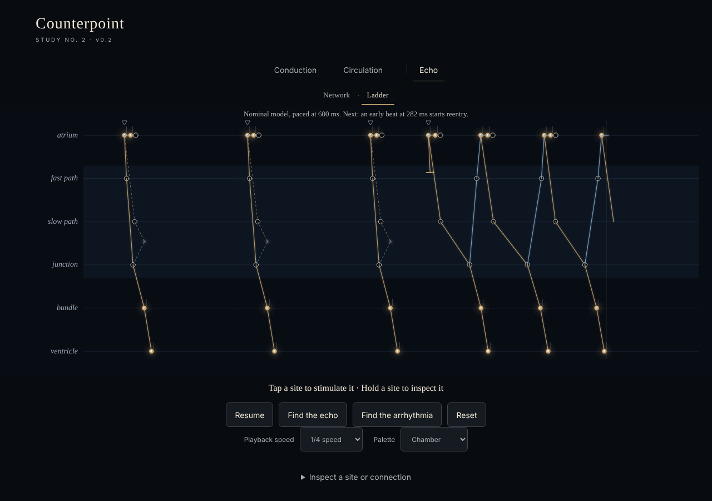

# Simplify M9 · no Stillness; one-press echo and arrhythmia

**Date:** 2026-11-27 · **Branch:** `study-2-guided`

## Stillness removed

The Stillness button, the press-and-hold on the open centre, the hint text and the screen dimming are all gone from the app. The engine keeps `applyAgent` because the frozen contract v1.1 and its oracle tests define it. Nothing in the app sends it.

## Find the echo · Find the arrhythmia

"A way for the user to quickly see an echo beat and quickly trigger arrhythmia. It can change the model settings to nominal and precondition the model."

- **Nominal model.** A guided run does not carry the player's inspector edits; it starts from the study defaults. Other runs (Reset, taps) still carry edits.
- **Preconditioned.** The S1 drive (8 beats at 600 ms from CSp) runs silently, and playback starts 100 ms before the decisive S2. The ladder still shows the earlier beats as context.
- **One press, one behaviour.** The engine, with the nominal model and a single S2 from CSp, gives:

  | S2 (ms) | Result |
  |---|---|
  | ≥ 300 | fast pathway, no echo |
  | 266–298 | sustained AV-nodal reentry |
  | 240–264 | exactly one echo |
  | ≤ 238 | no echo (slow-pathway block) |

  The buttons sit in the middle of their windows, 12 ms from each edge:
  - **Find the echo:** S2 = 252 ms.
  - **Find the arrhythmia:** S2 = 282 ms. It was "Find the circuit"; it no longer uses an S3.
  
  Pressing again gives the same result; it no longer steps earlier each time.
- **Timing.** At 1/8 speed the echo appears about 3 s after the press.
- **Status line.** For example, "Nominal model, paced at 600 ms. Next: an early beat at 282 ms starts reentry."

## Fix found on the way

If a player typed a value in the inspector and closed the card before leaving the field, the browser fired the field's change after the card had closed, and the card threw an error. The card now ignores edits that arrive after it closes.

## Checks

- 190 Node tests pass. New tests cover:
  - the windows (240/252/264 → one echo; 266/282/298 → ≥10 laps; 238 and 300 → none);
  - a single S2 per button, presented 100 ms before it;
  - exactly one echo and sustained reentry;
  - an event history identical to the full run;
  - a silent eight-beat prelude, with the echo about 3 s after the press at 1/8 speed;
  - card edits after close are ignored.
- `host-integration` passes, and both Chromium suites pass on desktop and phone. The browser check edits FP's ERP, then presses Find the echo. It confirms:
  - the command log is just S1 and S2 (the edit did not carry);
  - there is exactly one echo;
  - Find the arrhythmia then gives repeated echo laps.
