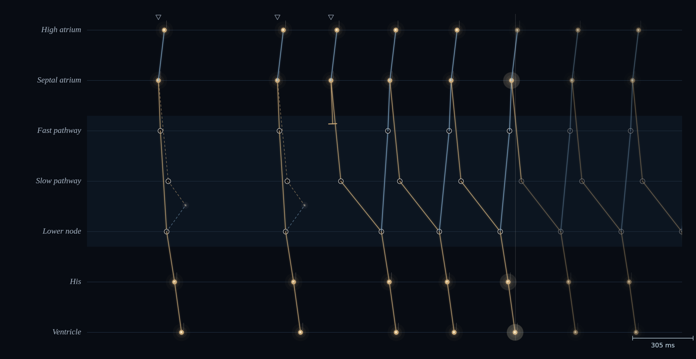
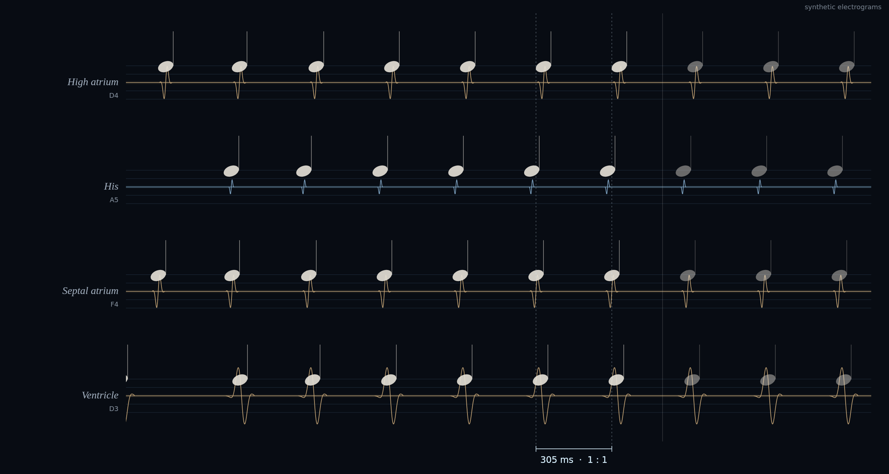
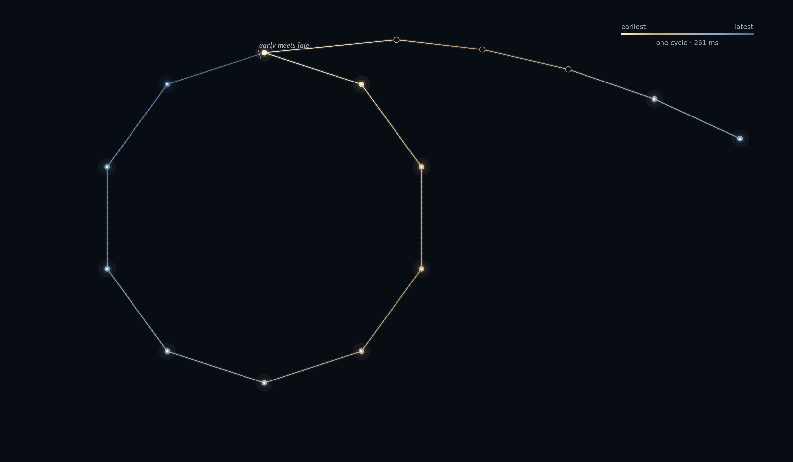
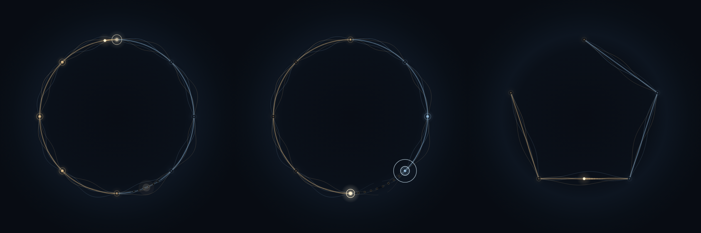

# Views 01 · Ladder, Staves, Map overlay, new Network marks (12b, 14a, 14c-part) · 2026-11-26

Branch `study-2-views`, based on study-2 at 43aeef2 (engine contract v1.1). All modules are Canvas 2D, DPR-aware (`dpr` argument, capped at 2.5), deterministic, and draw only from events. Colours use `ctx.globalAlpha`, so no colour strings are built per frame. Caches are bounded and keyed on the retained event array (identity and length).

## Files

| File | Purpose |
|---|---|
| `src/visuals/ladder.js` | `createLadder`, `traceMarks`, `normalizeTiers`, `tiersFromWorld` |
| `src/visuals/staves.js` | `createStaves`, synthetic kernels, calipers, `nearestSimpleRatio` |
| `src/visuals/map.js` | `createMap`, `deriveCycle`, `rampColor` |
| `src/visuals/marks.js` | `createNetworkMarks`, `traceNetworkMarks` |
| `src/visuals/trace.js`, `common.js` | shared causal classification (concealed, block, collision) and drawing helpers |
| `src/visuals/renderer.js` | additive: calls the new marks, `linkPoint`, `setOverlay` |
| `tests/views-{ladder,staves,map,marks}.test.js`, `views-scenes.js`, `views-snapshots.mjs` | 28 tests, scenes, PNG generator |

## API

### Ladder
```js
import { createLadder, tiersFromWorld } from '../visuals/ladder.js';
const ladder = createLadder({ tiers, siteLabels, silentSites });   // or tiers = tiersFromWorld(world)
const layout = ladder.draw(ctx, { events, presentedMs, windowMs = 3000, width, height, dpr, palette, intervals, reducedMotion, clear });
ladder.traceMarks(events);   // [{ id, kind, eventIds, t0, t1, y0, y1 (tier index), direction, delayMs, concealed, ... }]
ladder.layout({ width, height, windowMs, presentedMs });  ladder.markGeometry(mark, layout);
```
`tiers` is the world's `display.tiers`: `[{ id?, label?, group?, audible?, sites: [nodeId | { id, audible?, label? }] }]` (plain strings allowed). `silentSites` or `audible:false` on a world node draws open rings. Tiers with the same `group` share a faint band (the AV region). Sites not in any tier produce no marks.

Mark kinds: `activation` (pearl if audible, open ring if silent, with a note stem), `conduction` (gold antegrade, blue retrograde, slope is delay), `block` (line stops at 86% with a perpendicular bar; also a bare tier bar for a refused stimulus), `concealed` (dashed, dim, no bar), `collision` plus `collisionPoint` (soft point at the model position), `canceled`, `stimulus` (open triangle above the top tier, source `stimulus` only). Playhead at 72%. The classification uses all events given, so pass the committed events including lookahead; marks right of the playhead are drawn at half brightness. Reduced motion pages the window instead of scrolling and drops the bloom.

Concealed rule (trace.js): a launch is concealed when its tree never reaches an audible site, ends in block, collision or cancel, and either penetrated a silent site or started at one. A bare block at the first silent site keeps its bar (the premature touch in Echo).

### Staves
```js
const staves = createStaves({ staves: [{ nodeId, label, tissue, pitch }] });   // from display.staves
staves.draw(ctx, { events, presentedMs, windowMs, width, height, dpr, showSyntheticLabel });
staves.setCalipers(aMs, bMs); staves.clearCalipers(); staves.setReference(ms);
staves.readout(referenceMs?)  // { a, b, intervalMs, referenceMs, ratio: { p, q, text, errorMs } | null }
staves.timeAtX(x); staves.xAtTime(t); staves.snapToOnset(events, tMs, tolerancePx);   // pointer helpers (valid after a draw)
staves.meta  // { synthetic: true, label: 'synthetic' }
```
Kernels: atrial biphasic about 40 ms, His 12 ms small, ventricular 80 ms large (shapes from plate script). Overlapping kernels are summed exactly. Ratio is the nearest reduced p:q with terms up to 5 (`maxTerm` option).

### Map
```js
const map = createMap({ world, referenceNodeId });
const changed = map.update(events, presentedMs);   // true once per cycle, when the reference site activates again
map.draw(ctx, { nodePoint, linkPoint, width, height, legend, labels });
map.state / map.traceMarks()
```
The overlay shows the last completed cycle (reference activation to reference activation), so it is stable between boundaries. Latency of a site is its most recent activation modulo the cycle. The seam is the one link whose endpoints differ by more than half a cycle; colours wrap inside that link.

### Network marks
`createNetworkMarks({ world, geometry, palette, reducedMotion })` with `geometry = { nodePoint(id), linkColor(id), linkPoint(id, u), strokeLink(ctx, id, u0, u1, color, width, alpha) }`. `renderer.js` now creates it and calls `drawConcealedTransit` (dim dashed point fading mid-link instead of the normal head), suppresses the block ripple for blocks inside a concealed tree, and calls `draw(ctx, tMs, events)` for lesion beads and glow, phase arc (200 ms), fusion half rings (source colours), double-potential rings (gap = 3 + 11(1 - e^(-interval/200)) px, 3 to 14) and the entrainment arc (return within 20 ms of TCL, three captured pulses, closes over 240 ms). v1.0 worlds are pixel-identical (existing visual tests unchanged).

## Integration notes for src/ui/app.js
1. View switcher: keep one canvas per view or reuse one; call `ladder.draw` or `staves.draw` each frame with `presentedMs` from the runtime and the retained event history (the same array the Network renderer gets; prune by time, do not copy per frame).
2. Build `tiers` from `world.display.tiers` (`tiersFromWorld(world)` falls back to one tier per node) and staves from `world.display.staves`.
3. Calipers: on pointer drag convert x with `staves.timeAtX`, snap with `snapToOnset`, call `setCalipers`; the Lab sets `setReference` from a chosen interval.
4. Map: `renderer.setOverlay((ctx, { events, tMs }) => { map.update(events, tMs); map.draw(ctx, { nodePoint: renderer.nodePosition, linkPoint: renderer.linkPoint, width, height }); })` when the toggle is on. Create a new map to change the reference.
5. Call `setReducedMotion` on ladder, staves, map and renderer together.

## Checks
`npm test`: 120 tests pass (28 new). Parity (every mark cites existing events and every ladder-visible event is cited), slope equals delay (x extent equals `delayMs * pxPerMs`), block, collision, concealed (Wenckebach chain, blocks at N3 leave no bar), kernel determinism, caliper ratios (2:3, 3:4, 1:1, 1:2), map latencies and seam against engine times (Ostinato, L9), once-per-cycle redraw count, each Network mark from events (and absent when its event is removed), renderer integration.

Screenshots (generated by `node tests/views-snapshots.mjs`, native canvas, real engine runs; inspected against plates 1 to 3):






## Open issues
- `display.tiers` and `display.staves` do not exist in src/worlds yet (a worlds ticket); the modules take them as arguments.
- Ladder text uses system serif; plate uses EB Garamond. Fonts are not loaded by design.
- Concealed classification needs events beyond the playhead to settle; with no lookahead a silent tree draws as normal conduction until its end is known.
- Entrainment does not check unchanged activation order (spec step 2) and the Map has no listening-point drawing (separate ticket). Double-potential rings sit at the earlier flanking site and appear when the far side activates (interpretation of the spec).
- The Network-marks snapshot shows the chain world on the generic circle layout, not a designed one.
